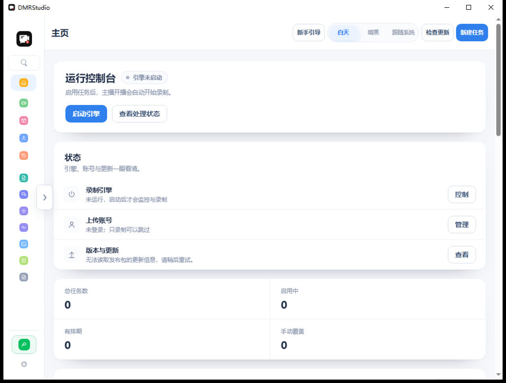
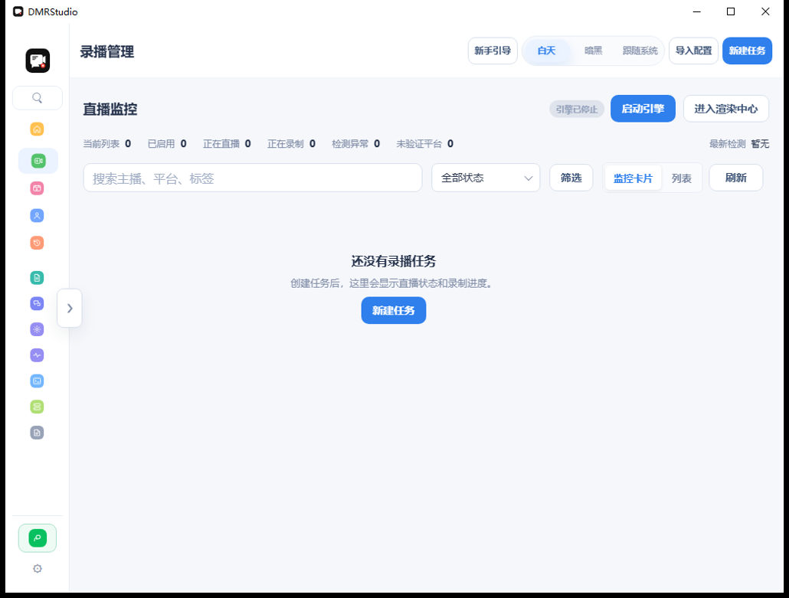
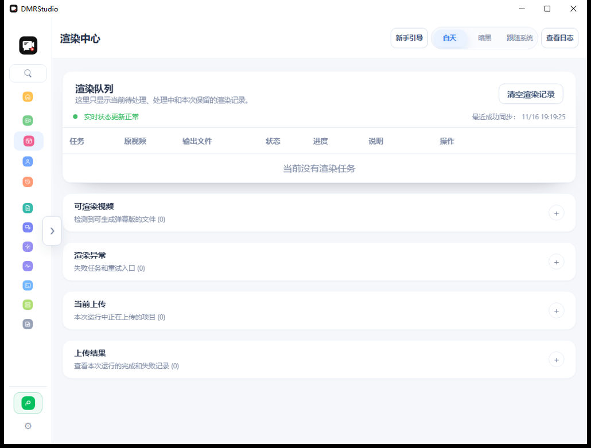
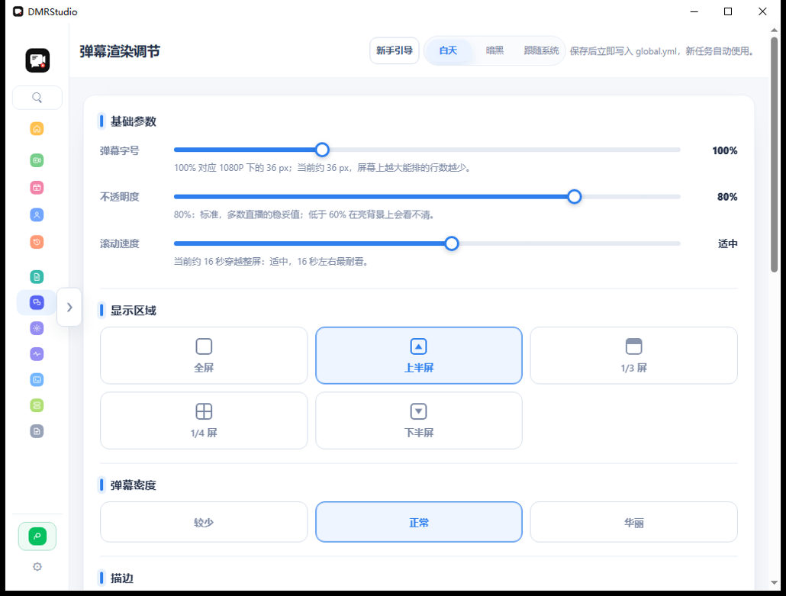
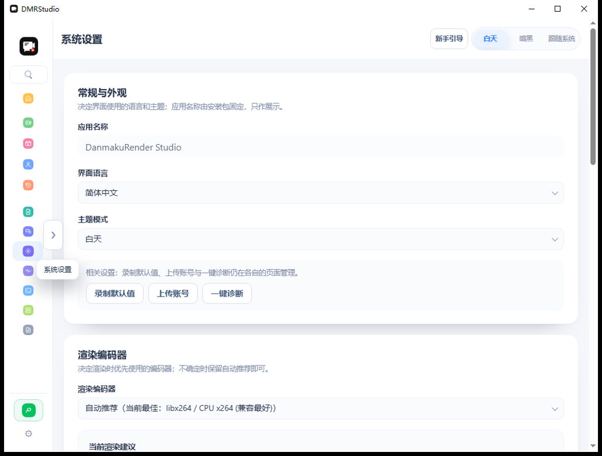

# DMR Studio — Windows Livestream Recorder & Danmaku Recording Tool

<strong>Language:</strong> <a href="README.md">简体中文</a> · <a href="README.en.md">English</a>

  

  <strong>DMR Studio</strong> is a Windows desktop application for <strong>automatic livestream recording</strong>, danmaku (live chat) capture and rendering, video processing, and recording task management. 
  A graphical interface helps users manage live recording without complex command-line setup.

  
  
  
  

  <a href="https://github.com/jiabenguiyin/DMRStudio/releases">Download for Windows</a> ·
  <a href="https://github.com/jiabenguiyin/DMRStudio/releases">Release notes</a> ·
  <a href="https://github.com/jiabenguiyin/DMRStudio/issues">Report an issue</a>

## What is DMR Studio?

If you're searching for a **livestream recorder**, **automatic live stream recording software**, **stream recording tool**, or **danmaku recorder** for Windows, DMR Studio brings recording and day-to-day management into one desktop interface.

It is designed to record live streams, manage recording jobs, save and render associated danmaku, and handle optional video uploads. Most recording and processing activities run locally on the user's computer.

**Languages:** Simplified Chinese and English. Switch between them in **System Settings → Interface Language**. You do not need a separate English installer.

## Screenshots

The following images were captured from **DMR Studio v1.0, Build 18, running on Windows**. These are actual application screenshots, not mockups. No live-recording tasks or upload accounts were configured in the test environment, so the queues are empty.

  

Dashboard — engine controls and recording status

| Livestream task management | Render center |
|:---:|:---:|
|  |  |
| **Recording tasks** — live monitoring and job status | **Render center** — queues, errors and upload history |
|  |  |
| **Danmaku settings** — font size, opacity and display layout | **System settings** — language, theme and encoder |

*Note: The pictured application was set to Simplified Chinese; the English UI is selectable in Settings.*

## Features

- **Automatic livestream recording:** Organize and monitor recording tasks based on stream and task status.
- **Segmented recordings:** Split long live recording sessions into manageable files.
- **Danmaku capture and rendering:** Save supported live-chat data and render it with video using configured settings.
- **Recording task management:** Create, enable, pause and adjust jobs; inspect activity and status.
- **Rendering and optional uploads:** Process recordings and upload videos through configured platform accounts when enabled.
- **Windows desktop workflow:** Graphical settings, system tray access, Windows installer and upgrade support.
- **Simplified Chinese / English interface:** Choose the interface language without installing a different edition.

Available integrations, recording methods and individual features may depend on your version, stream platform and configuration.

## Getting Started

1. Download the latest Windows installer from [GitHub Releases](https://github.com/jiabenguiyin/DMRStudio/releases).
2. Install and launch DMR Studio from the desktop, Start menu or system tray.
3. To use English, open **System Settings → Interface Language → English**.
4. Create a livestream recording task and adjust monitoring, segmented recording, danmaku, rendering and upload options as needed.
5. Check recording status in the task manager and manage output files on your PC.

If Windows SmartScreen warns about an unknown publisher, confirm the installer was downloaded from this repository's official release page. The installer may not be digitally signed.

## Frequently Asked Questions

### Is this a screen recorder or a livestream recorder?

DMR Studio focuses on livestream data recording and task management rather than only capturing pixels on your desktop. It is intended for users who want to monitor live streams and save recordings automatically.

### Does it automatically create highlight clips?

Not as a confirmed feature of this release. Segmented recording and danmaku rendering can help prepare material for **livestream clips and highlight editing**, but splitting a recording is not the same as automatically identifying highlights.

### Do I need command-line experience?

The goal is to keep common recording workflows accessible through a graphical Windows application.

### Do recordings have to be stored in the cloud?

Recording and processing primarily take place on your local computer. Uploading videos is optional and depends on task configuration.

## Releases and Feedback

The current public product version is **v1.0**. See [Releases](https://github.com/jiabenguiyin/DMRStudio/releases) for the available installer and latest release details.

For installation issues, recording failures, danmaku problems or application errors, please open an [Issue](https://github.com/jiabenguiyin/DMRStudio/issues). Include reproduction steps, software version and relevant screenshots if possible. **Never share login cookies, access tokens or account credentials publicly.**

This repository publishes product information and releases. The application source code is maintained separately.
