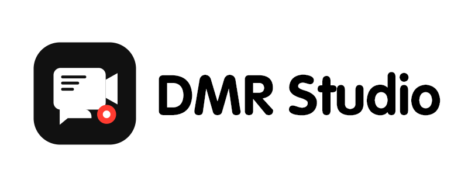
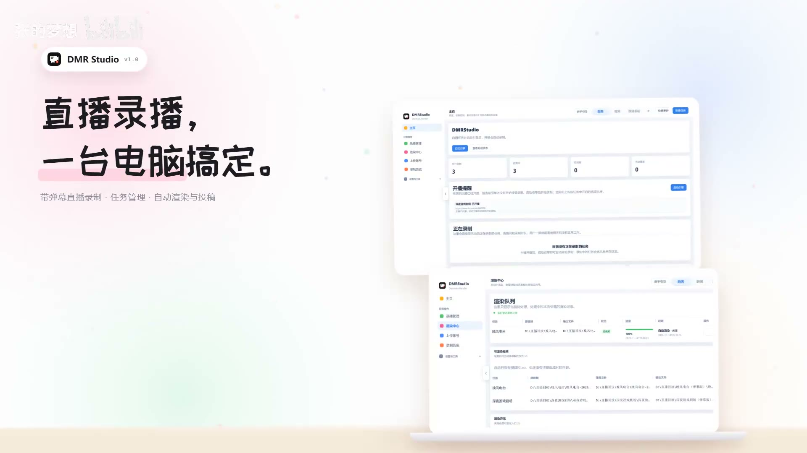
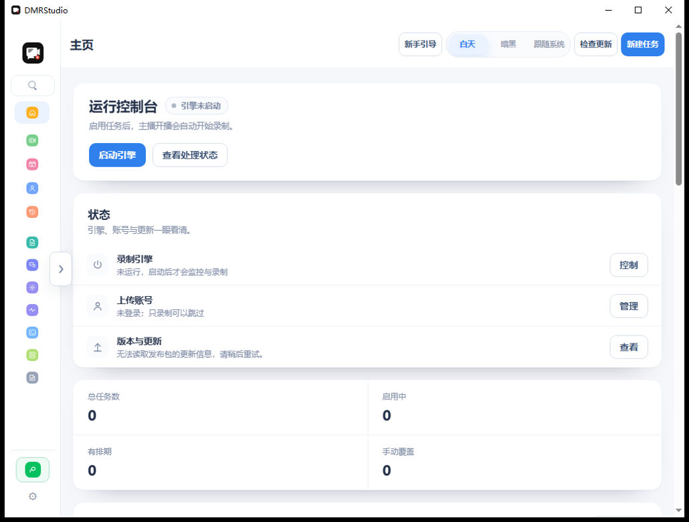
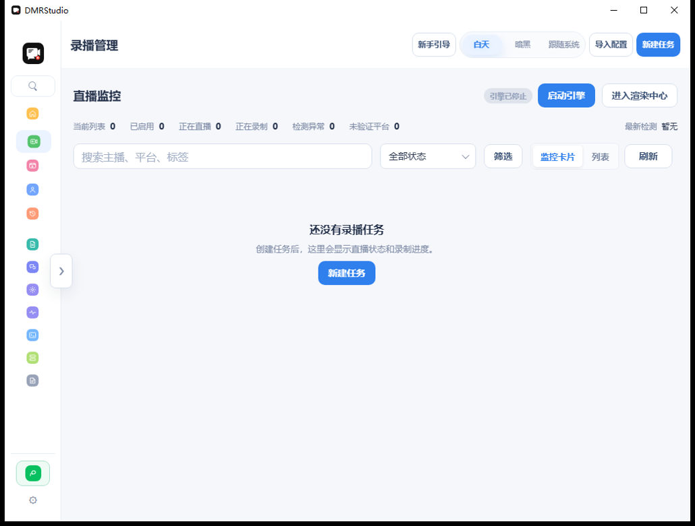
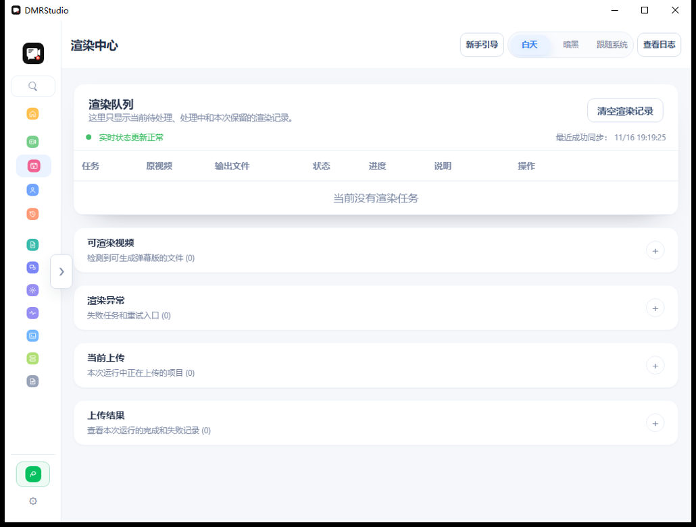
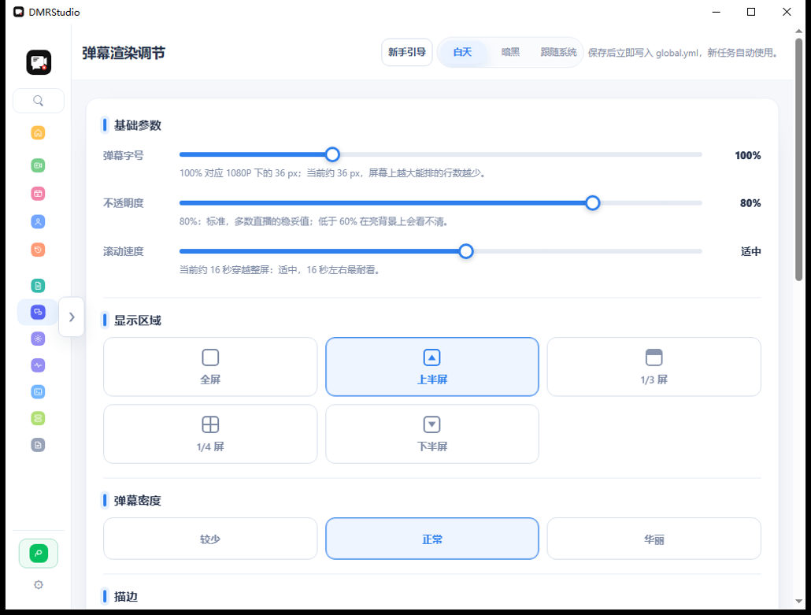
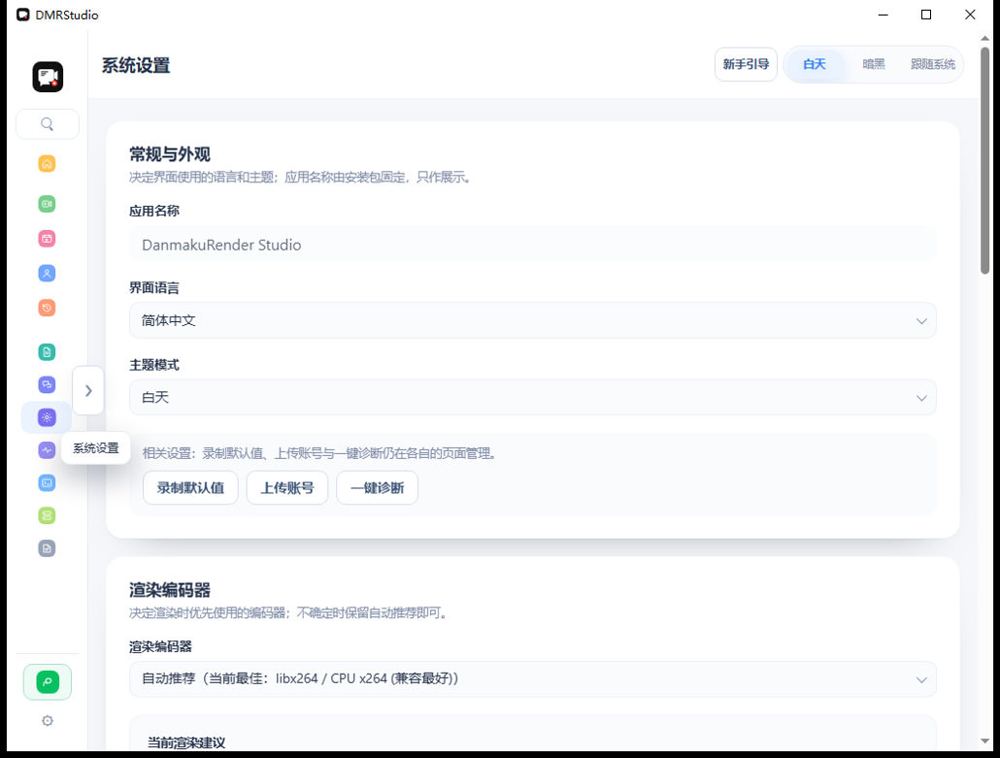

# DMR Studio — Windows 直播录播软件｜自动录制、弹幕录制与录播管理

<strong>语言 / Language：</strong> <a href="README.md">简体中文</a> · <a href="README.en.md">English</a>

  

  一款面向 Windows 用户的<b>直播自动录制与录播管理工具</b>。 
  使用图形界面管理直播间监控、自动录制、分段录像、弹幕录制、弹幕渲染与视频上传，尽量减少新手的配置负担。

  
  
  
  

  <a href="https://github.com/jiabenguiyin/DMRStudio/releases">下载 Windows 安装包</a> ·
  <a href="https://github.com/jiabenguiyin/DMRStudio/releases">查看更新日志</a> ·
  <a href="https://github.com/jiabenguiyin/DMRStudio/issues">反馈问题</a>

<i>DMR Studio is a Windows livestream recorder with automatic recording, danmaku capture and rendering, recording task management, and video upload. English UI is available.</i>

## DMR Studio 是什么？

如果你正在寻找**直播录播软件、直播自动录制工具、弹幕录制软件**，希望不用反复手动开启录屏就能保存直播回放，可以了解一下 DMR Studio。

DMR Studio 是一款用于录制主播直播间的 Windows 桌面程序。它将录制、弹幕渲染、上传、任务管理和常用设置整合在图形化界面中，让新手也能比较容易地上手。程序的录制与处理工作主要在自己的电脑上完成。

## 产品演示视频

**DMR Studio 1.0 正式发布宣传片（32 秒）**：了解 Windows 直播录播、开播自动录制、弹幕渲染及自动投稿的使用场景。

  

<strong>▶ <a href="docs/media/DMRStudio-v1.0-promo.mp4">点击观看 32 秒官方演示视频</a></strong> · <a href="https://github.com/jiabenguiyin/DMRStudio/releases">下载 Windows 正式版</a>

> 视频为功能介绍演示。具体平台可用性、录制及上传能力以当前版本与实际配置为准。

## 软件界面预览

以下为 **DMR Studio v1.0 在 Windows 测试环境中实际运行的截图**，不是设计效果图。测试环境未添加直播任务、未登录上传账号，因此任务与渲染队列显示为空；后续版本界面可能调整。

  

首页 · 运行控制台与录制状态

| 直播录播任务管理 | 渲染中心 |
|:---:|:---:|
|  |  |
| **录播管理** · 直播监控与任务状态 | **渲染中心** · 处理队列、异常与上传记录 |
|  |  |
| **弹幕渲染调节** · 字号、透明度与显示区域 | **系统设置** · 语言、主题及渲染编码器 |

## 主要功能

- **直播间监控与自动录制**：集中管理直播录制任务，按任务设置和直播状态运行。
- **分段录像与文件管理**：支持分段录制，便于整理较长时间的直播素材。
- **弹幕录制与弹幕渲染**：保存相关弹幕内容，并按配置处理带弹幕的录播视频。
- **录播任务管理**：在桌面端添加、启用、暂停和调整任务，查看录制与运行状态。
- **渲染与上传管理**：在录制后按配置处理视频，并使用已配置的平台账号进行上传。
- **图形界面和托盘常驻**：集中整理常用设置，支持从系统托盘进入程序和执行快捷操作。
- **覆盖升级尽量保留数据**：提供安装、升级与卸载入口；升级时尽量保留现有配置、任务数据和登录信息。
- **简体中文 / English 双语界面**：在「系统设置 → 界面语言」中切换中文或英文，适合不同地区用户。

具体可用的平台、录制方式及功能以当前版本的界面和设置为准。

## 平台兼容性与使用教程

DMR Studio 的直播平台适配实现涵盖 **B站（Bilibili）、抖音（Douyin）、虎牙（Huya）、斗鱼（Douyu）及 Twitch**，提供直播流监控、自动录播及部分平台的弹幕采集接口。具体能否录制成功，请以当前网络与平台接口状态为准；平台适配并非全部房间的实测保证。

- **[Windows 直播自动录制新手教程](docs/quick-start.md)**：从下载安装、粘贴直播间链接、新建录播任务到启动引擎、验证录像文件。
- **[平台支持列表与兼容性说明](docs/platforms.md)**：区分直播录制、弹幕录制、视频下载和 B站 / YouTube 自动投稿，避免误认功能。

支持 **简体中文 / English 双语界面**。英文用户请查看 [English quick start](docs/quick-start.en.md) 和 [platform compatibility](docs/platforms.en.md)。

## YAML 高级配置与 DanmakuRender 兼容

需要进一步调整直播录制、弹幕样式、分段时长、FFmpeg 渲染或自动投稿？查看 **[DMR Studio YAML 配置详解](docs/yaml-configuration.md)**（兼容性说明、参数参考、四份安全配置示例），避免直接套用 DanmakuRender 上游专有参数。英文版：[YAML Configuration Guide](docs/yaml-configuration.en.md)。

## 新手入门

1. 前往 [Releases 发布页](https://github.com/jiabenguiyin/DMRStudio/releases) 下载最新 Windows 安装包。
2. 安装后打开 DMR Studio，在图形界面中配置直播录制任务。
3. 根据需要启用直播监控、弹幕录制、分段录制、渲染或自动上传。
4. 从任务和状态页面查看录播进度，并在本机管理录制文件。

如果 Windows SmartScreen 提示发布者未知，请先确认安装包来自本仓库的正式 Release；当前版本安装包可能尚未进行代码签名。

## 常见问题

### 这是直播录屏软件，还是直播录播工具？

DMR Studio 主要面向**直播流录制与录播任务管理**，并非只依靠屏幕捕获来保存视频。它适合希望长期监控直播间、自动保存直播回放的用户。

### 能当直播切片软件使用吗？

录播和切片是两个不同环节。DMR Studio 支持录制、分段录像和弹幕渲染，可为后续制作**直播切片、精彩片段、短视频剪辑**保留素材；但**分段录制不等于自动识别精彩片段**，请勿将它理解为已经具备全自动智能切片功能。

### 不熟悉命令行也能用吗？

产品的设计目标就是降低操作门槛。常见录播任务与设置可以通过 Windows 桌面界面完成，不需要先研究复杂的命令行操作。

### 需要把直播视频上传到云端吗？

录制与处理主要在本机进行；是否启用视频上传及上传到何处，由相应任务配置决定。

## 当前版本与更新

目前正式产品版本为 **1.0**。安装包和具体更新内容以 [GitHub Releases](https://github.com/jiabenguiyin/DMRStudio/releases) 为准，后续会继续改进桌面端交互、录制稳定性与常用功能。

## 反馈与说明

- 如遇到录制失败、弹幕问题、任务异常或安装错误，请前往 [Issues](https://github.com/jiabenguiyin/DMRStudio/issues) 反馈。
- 建议提供复现步骤、Windows 系统版本、软件版本以及必要的截图或诊断信息；请勿公开 Cookie、Token 或其他登录凭据。
- 本仓库用于产品介绍和安装包发布，应用源码另行维护。
